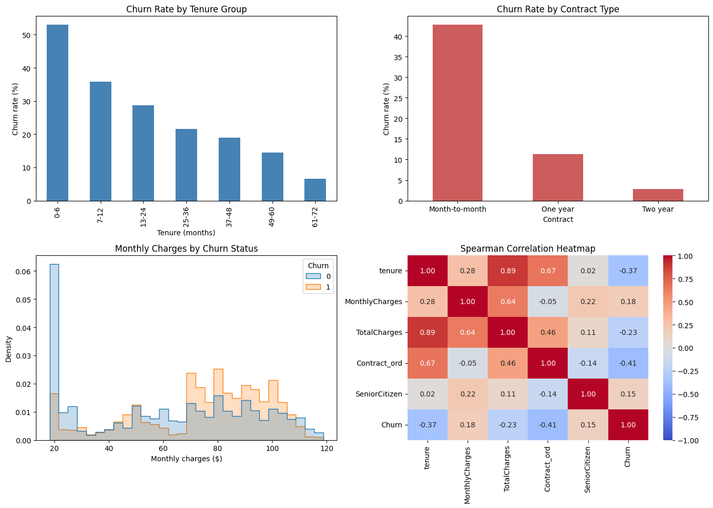
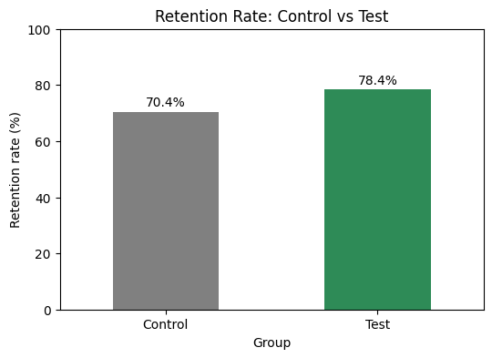

# Telco Customer Churn Analysis

Exploratory analysis of customer churn at a telecom company, with a churn prediction use case and a simulated A/B test to evaluate it.
Final project for DS 204 at Cornerstone International Community College of Canada (CICCC).



## Problem
Which customers are most likely to cancel their service, and could a churn prediction model help the retention team keep more of them?

## Data
- **Source:** [Telco Customer Churn – Kaggle (IBM sample data)](https://www.kaggle.com/datasets/blastchar/telco-customer-churn)
- **Size:** 7,043 customers × 21 columns (demographics, services, contract, billing, and churn)
- **Target:** `Churn` (Yes/No). 26.5% of customers churned.

## What I did
1. **Data quality checks:** found 11 hidden blank values in `TotalCharges` (stored as text), 22 repeated customer profiles, and redundant categories such as "No internet service".
2. **Cleaning:** converted `TotalCharges` to numeric (blanks are new customers with tenure 0, filled with 0), recoded redundant categories, and encoded Yes/No columns as 1/0.
3. **Association analysis:** compared Pearson (point-biserial), Spearman, Kendall, and Cramér's V, and chose the most appropriate measure for each feature type.
4. **Prediction use case:** defined churn prediction as a binary classification problem and selected input features based on the analysis.
5. **Simulated A/B test:** designed an experiment to test whether model-guided retention improves results, evaluated with a one-tailed two-proportion z-test.

## Key findings
| Driver | Churn rate |
|---|---|
| Month-to-month vs. two-year contract | 42.7% vs. 2.8% |
| First 6 months vs. over 5 years of tenure | ~53% vs. ~6.5% |
| Fiber optic vs. DSL internet | 41.9% vs. 19.0% |
| Electronic check vs. automatic payment | 45.3% vs. ~15–17% |
| Without vs. with Tech Support | 31.2% vs. 15.2% |

- **Contract type** has the strongest association with churn (Cramér's V = 0.41), followed by **tenure** (Spearman = -0.37).
- `TotalCharges` is highly correlated with `tenure` (Spearman = 0.89), so it was treated as redundant.

## Simulated A/B test


| Group | Customers | Retention rate |
|---|---|---|
| Control (current reactive process) | 500 | 70.4% |
| Test (model-guided retention) | 500 | 78.4% |

Z = 2.898, p = 0.0019, so H0 is rejected at α = 0.05.
**Note:** the outcomes are **simulated** (customer profiles were sampled from the real data, but retention was generated with an assumed effect). This section demonstrates the experiment design and statistical test, not a real business result.

## Repository structure
```
telco-churn-analysis/
├── telco_churn_analysis.ipynb   # full analysis
├── data/                        # place the Kaggle CSV here (not included)
├── images/                      # charts used in this README
├── requirements.txt
└── README.md
```

## How to run
1. Download `WA_Fn-UseC_-Telco-Customer-Churn.csv` from [Kaggle](https://www.kaggle.com/datasets/blastchar/telco-customer-churn) and save it in `data/`.
2. Install the dependencies:
   ```bash
   pip install -r requirements.txt
   ```
3. Open and run the notebook:
   ```bash
   jupyter notebook telco_churn_analysis.ipynb
   ```

## Tools
Python, pandas, NumPy, Matplotlib, seaborn, SciPy, statsmodels, ydata-profiling
